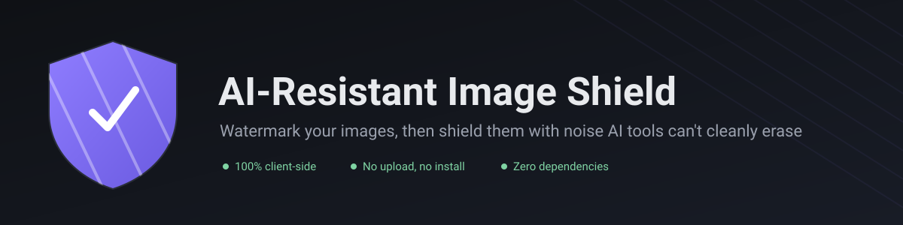
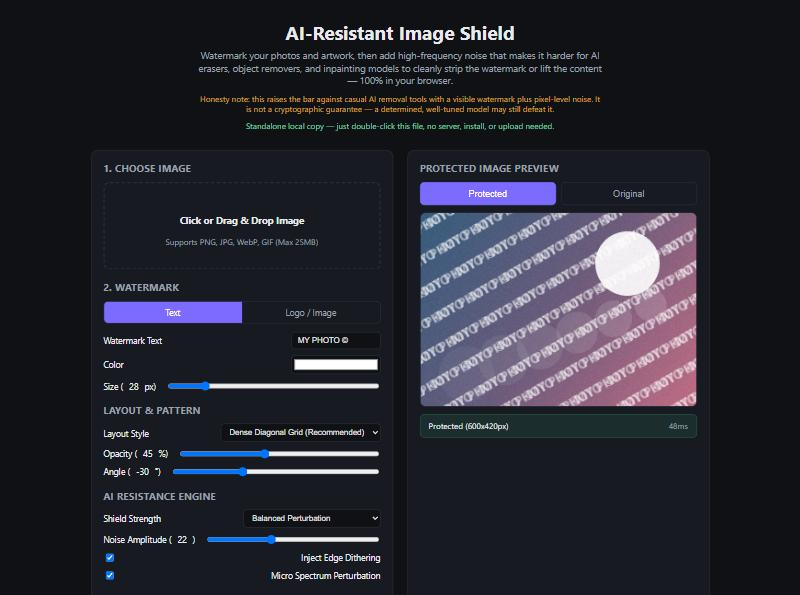

<p align="center">
  
</p>

<p align="center">
  
  
  
  
</p>

Watermarks a photo or artwork and layers on high-frequency pixel noise, so casual
AI erasers, object-removal tools, and inpainting models have a harder time cleanly
stripping the watermark or lifting the underlying content. Runs entirely in your
browser &mdash; no image is ever uploaded anywhere.

## Screenshot

<p align="center">
  
</p>

## Honesty note

The "AI Resistance Engine" adds a tiled/stamped watermark plus per-pixel random and
structured high-frequency noise (optionally concentrated along image edges). This
raises the bar against simple clone-stamp/inpainting tools and makes the watermark
harder to cleanly erase. It is **not** a cryptographic guarantee and is not a
substitute for a real adversarial-perturbation attack tuned against a specific model
&mdash; a sufficiently capable, well-tuned AI model may still remove it.

## Features

- **Watermark overlay** &mdash; text or logo image, with color, size, opacity, angle,
  and four layout patterns: dense diagonal grid, center stamp, corner stamp, repeat grid.
- **AI Resistance Engine** &mdash; adjustable noise amplitude and a shield-strength
  preset (Maximum / Balanced / Low / Disabled), with optional edge-concentrated
  dithering and a structured micro high-frequency perturbation.
- **Before/after preview** toggle and export as PNG (lossless), JPEG, or WebP.
- **Zero dependencies, zero build step, zero network calls** &mdash; a single HTML
  page, a stylesheet, and a plain JS file. Open `index.html` directly (double-click,
  or `file://`); no server or install required.

## Getting started

Just open `index.html` in a browser. There's no `npm install`, no dev server, no backend.

```bash
git clone <this-repo-url>
cd ai-resistant-image
# then just open index.html in your browser
```

## Files

- `index.html` &mdash; page structure and controls
- `style.css` &mdash; styling
- `app.js` &mdash; canvas watermark + noise engine and all UI wiring
- `docs/` &mdash; README assets (logo, banner, screenshot)

## License

[MIT](LICENSE)
